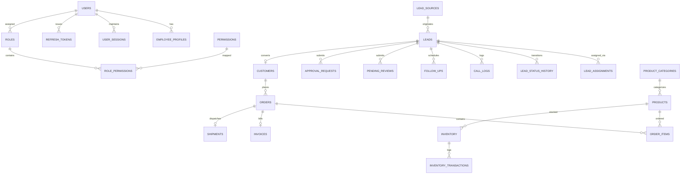

# Database Architecture Specification

## 1. Storage Engine & Database Philosophy
- **Database**: **PostgreSQL 16 Enterprise**
- **ORM**: **Prisma ORM 6.x**
- **Schema Design Philosophy**:
  - Normalized relational structure (3NF) ensuring referential integrity.
  - Foreign key constraints on every parent-child association.
  - Immutable historical tables (`lead_assignments`, `lead_status_history`, `call_logs`, `audit_logs`) to prevent loss of operational context.
  - Enforced UTC timezone for all timestamp columns (`TIMESTAMPTZ`).
  - Strict unique indexes on natural keys (e.g., employee code, order number, invoice number, phone deduplication).

## 2. High-Level Entity Domains

## 3. Indexing & Optimization Strategy
- **Primary Keys**: UUID v4 or CUID2 for distributed scalability and zero enumeration risk.
- **Composite Indexes**:
  - `leads(status, assigned_to_id)` for fast salesperson workspace queries.
  - `leads(phone_number)` with normalized digits for instant duplicate lookups.
  - `call_logs(lead_id, created_at DESC)` for chronological calling history display.
  - `orders(customer_id, status)` for customer order history lookups.
  - `audit_logs(entity_type, entity_id, created_at DESC)` for fast compliance audits.
