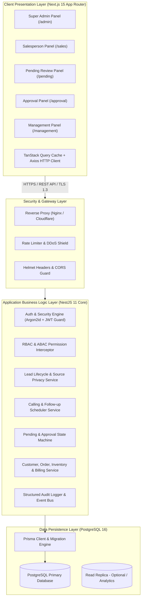

# System Architecture Specification

## 1. Architectural Topology
The **MELAYURVEDA Enterprise CRM** is architected as a modern, decoupled three-tier system:

## 2. Core Architectural Principles
1. **Single Source of Truth**: The PostgreSQL database is the sole authoritative store of all enterprise records. Frontend state is transient and synchronized via TanStack Query.
2. **Backend-Enforced Business Rules**: No critical business decision, status validation, or permission verification relies on frontend logic. The NestJS backend validates all invariants.
3. **Immutability of Audit Trails**: State transitions, call logs, assignment shifts, and administrative decisions generate immutable historical records.
4. **Principle of Least Privilege**: Users are granted the minimum necessary permissions required to fulfill their business function.
5. **Fail-Safe Data Isolation**: Lead source metadata is quarantined from sales access through architectural DTO separation.
