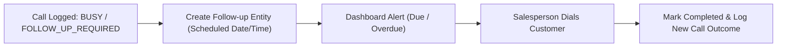

# Follow-Up Workflow Specification

## 1. Follow-Up Lifecycle
Follow-ups ensure that prospective customers who request additional consultation time or callbacks are contacted reliably without leads slipping through the cracks.

## 2. Follow-Up Categorization & SLAs
- **Scheduled**: Future date/time selected.
- **Due Today**: Scheduled for the current calendar day in the user's timezone.
- **Overdue**: Scheduled time has elapsed without a subsequent call log. Overdue count appears highlighted in red on the Salesperson Dashboard.
- **Completion**: A follow-up is automatically marked `COMPLETED` when the assigned salesperson records a new call log for that lead.
