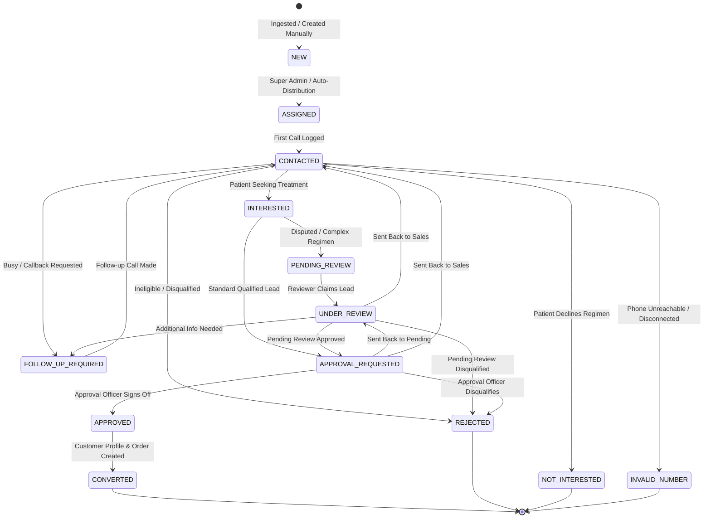

# Lead Lifecycle State Machine Specification

## 1. Complete Lifecycle Workflow Diagram
The following state machine governs every lead in the MELAYURVEDA CRM:

## 2. Defined States & Business Semantics
| State Code | Name | Description |
|:---|:---|:---|
| `NEW` | Fresh Lead | Ingested via marketing channel or manually entered; currently unassigned in the global intake pool. |
| `ASSIGNED` | Allocated to Sales | Assigned to a specific salesperson (`MEL-SAL-XXX`); pending initial consultation call. |
| `CONTACTED` | Contact Initiated | At least one call outcome has been recorded by the assigned salesperson. |
| `FOLLOW_UP_REQUIRED` | Follow-Up Scheduled | Call outcome requires a future scheduled contact; explicit follow-up timestamp recorded. |
| `INTERESTED` | Qualified Interest | Patient expressed definitive interest in Melayurveda Ayurvedic formulations. |
| `PENDING_REVIEW` | In Pending Queue | Submitted by salesperson for triage, pricing validation, or clinical verification. |
| `UNDER_REVIEW` | Audit Active | Claimed by a pending reviewer (`MEL-PND-XXX`) for active audit and verification call. |
| `APPROVAL_REQUESTED`| Approval Queue | Passed initial triage and waiting for final sign-off from Approval Officer. |
| `APPROVED` | Validated Lead | Cleared clinical and commercial criteria; authorized for customer creation and order fulfillment. |
| `CONVERTED` | Active Customer | Successfully transformed into a permanent customer record with an order draft or confirmed purchase. |
| `NOT_INTERESTED` | Prospect Declined | Lead explicitly rejected Ayurvedic care; archived with retention policy. |
| `INVALID_NUMBER` | Defective Contact | Phone number dead, invalid digit count, or unreachable after 3 spaced attempts. |
| `REJECTED` | Disqualified | Permanently disqualified by reviewer or approval officer with recorded justification. |

## 3. Strict Transition Rules & Guardrails
- **No Direct Leaps**: A salesperson cannot change a lead directly from `NEW` to `APPROVED` or `CONVERTED`. All transitions must flow through intermediate validation states.
- **Role Invariants**:
  - Only `SUPER_ADMIN` and assignment engines can transition `NEW` -> `ASSIGNED`.
  - Only `SALESPERSON` (or Admin) can transition `ASSIGNED` -> `CONTACTED`, `INTERESTED`, `FOLLOW_UP_REQUIRED`, or `PENDING_REVIEW`.
  - Only `PENDING_REVIEWER` can transition `UNDER_REVIEW` -> `APPROVAL_REQUESTED`, `REJECTED`, or `SEND_BACK`.
  - Only `APPROVAL_OFFICER` can transition `APPROVAL_REQUESTED` -> `APPROVED`, `REJECTED`, or `SEND_BACK`.
  - Only `MANAGEMENT` or `SUPER_ADMIN` can transition `APPROVED` -> `CONVERTED`.
- **Audit Requirement**: Every transition writes a record to `lead_status_history` capturing: `lead_id`, `from_status`, `to_status`, `changed_by_user_id`, `reason`, and `timestamp`.
