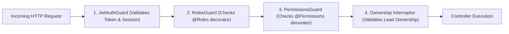

# API Authorization & Guard Architecture

## 1. Guard Pipeline
Every inbound API request passes through a sequential chain of security guards:



## 2. Resource Ownership Validation (Anti-IDOR)
When a salesperson accesses a lead (`GET /api/v1/leads/:id` or `POST /api/v1/calling/logs`):
- The service executes an ownership assertion:
  ```typescript
  if (currentUser.role === Role.SALESPERSON && lead.assignedToId !== currentUser.id) {
    throw new ForbiddenException('You are not authorized to access or modify this lead.');
  }
  ```
- This completely prevents Insecure Direct Object Reference (IDOR) attacks across sales accounts.
