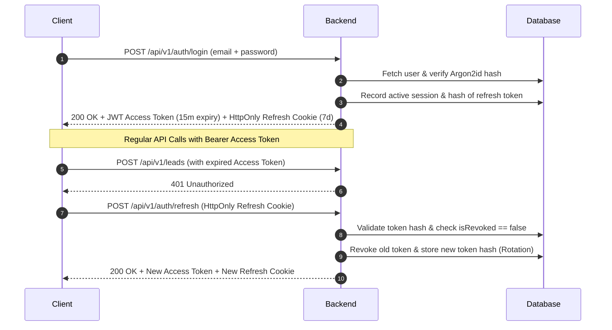

# Authentication Architecture & Token Lifecycle

## 1. Dual-Token Architecture
The CRM utilizes a short-lived access token paired with rotating refresh tokens:

## 2. Refresh Token Rotation & Theft Detection
- Every refresh operation burns the incoming token and issues a brand-new token pair.
- If a revoked token is presented, the system detects a token reuse anomaly, invalidates the entire token family, terminates the session, and triggers a security audit event.
